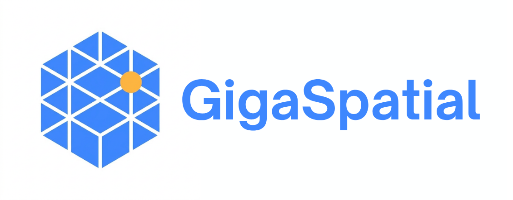
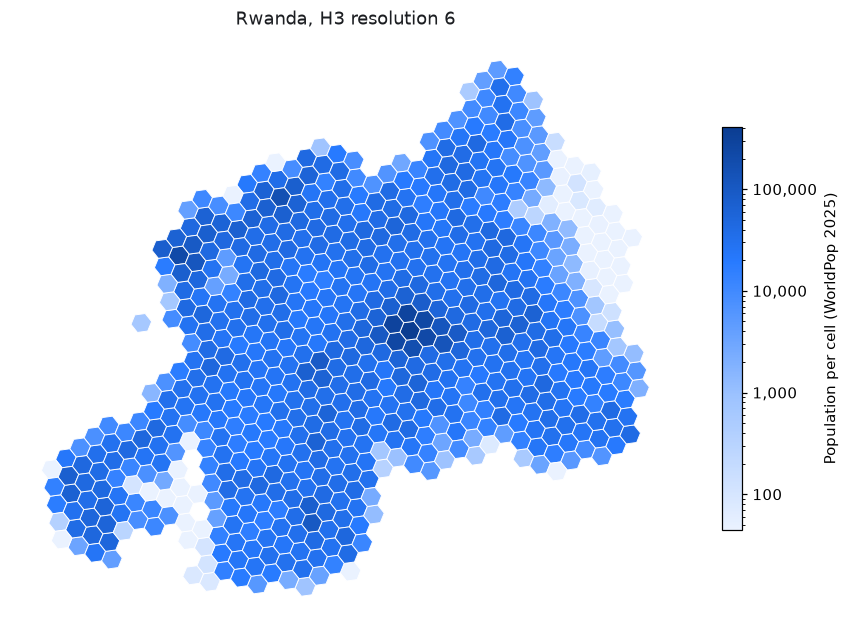

<p align="center">
  <a href="https://unicef.github.io/giga-spatial/">
    
  </a>
</p>

<p align="center">
  <a href="https://pypi.org/project/giga-spatial/"></a>
  <a href="https://pypi.org/project/giga-spatial/"></a>
  <a href="https://github.com/unicef/giga-spatial/blob/main/LICENSE"></a>
  <a href="https://pepy.tech/projects/giga-spatial"></a>
  <a href="https://unicef.github.io/giga-spatial/"></a>
</p>

GigaSpatial acquires published geospatial datasets into a data store you control, loads them for a source, and processes them. A generator maps a dataset onto points of interest or zones, and the result is a view: those places with attributes from the datasets attached. It started in UNICEF's [Giga](https://giga.global/) initiative.

Use it for humanitarian, development, connectivity, and climate analysis: map population, building footprints, wealth, and flood hazard onto grids (H3 hexagons, S2 cells, Mercator tiles), administrative boundaries, or custom geometries; estimate population and nearest buildings around points of interest (such as schools, clinics, or cell sites); combine WorldPop, building footprints, and OpenStreetMap into one country dataset in a few lines of Python; and route or connect places along OpenStreetMap road networks.

## What it covers

- **[Handlers](https://unicef.github.io/giga-spatial/latest/api/handlers/)** acquire datasets published as files, keep them in your data store, and load them for a country or geometry:
  - **Population and settlement**: WorldPop (`WPPopulationHandler`) and GHSL (`GHSLDataHandler` for `GHS_POP`, `GHS_BUILT_S`, `GHS_SMOD`, building height, and volume)
  - **Building footprints**: Google-Microsoft combined buildings (`GoogleMSBuildingsHandler`), Google Open Buildings (`GoogleOpenBuildingsHandler`), and Microsoft Global Buildings (`MSBuildingsHandler`)
  - **OpenStreetMap road networks**: country-scale road networks from Geofabrik extracts (`OSMRoadsHandler`)
  - **Socioeconomic and humanitarian**: Meta Relative Wealth Index (`RWIHandler`) and Humanitarian Data Exchange (`HDXHandler`)
  - **Connectivity and infrastructure**: Ookla Speedtest tiles (`OoklaSpeedtestHandler`) and OpenCellID cell towers (`OpenCellIDHandler`)
  - **Terrain and flood hazard**: NASA SRTM elevation (`NasaSRTMHandler`), Copernicus GloFAS river flood hazard (`GlofasHandler`), and WRI Aqueduct flood hazard (`AqueductFloodHandler`)
  - **Administrative boundaries**: `AdminBoundaries`
- **[Fetchers](https://unicef.github.io/giga-spatial/latest/api/fetchers/)** query datasets served by an API or database: OpenStreetMap places (`OSMLocationFetcher`) and road networks (`OSMRoadsFetcher`), Giga schools (`GigaSchoolLocationFetcher`, `GigaSchoolProfileFetcher`, `GigaSchoolMeasurementsFetcher`, `GigaCountriesFetcher`), Healthsites.io (`HealthSitesFetcher`), Overture Maps amenities (`OvertureAmenityFetcher`), UNICEF SDG indicators (`UnicefDataFetcher`), M-Lab speed tests in BigQuery (`MLabFetcher`), and Google Earth Engine (`GEEProfiler`).
- **[Generators](https://unicef.github.io/giga-spatial/latest/api/generators/)** map datasets onto points of interest (`PoiViewGenerator`) or zones (`H3ViewGenerator`, `S2ViewGenerator`, `MercatorViewGenerator`, `AdminBoundariesViewGenerator`, `GeometryBasedZonalViewGenerator`) and return a view.
- **[Processing](https://unicef.github.io/giga-spatial/latest/user-guide/processing/)** provides raster (`TifProcessor`) and vector tools for the stored files.
- **[Road networks](https://unicef.github.io/giga-spatial/latest/user-guide/road-networks/)**: `OSMRoadsFetcher` fetches OpenStreetMap roads for a source, `OSMRoadsHandler` builds them for whole countries from Geofabrik's extracts, and `SpatialNetwork` and `ConnectionPlanner` join schools or other points to them, find shortest paths, and plan the roads that connect a set of points.

Files live in a [data store](https://unicef.github.io/giga-spatial/latest/api/data-stores/): local disk (`LocalDataStore`), Azure Data Lake Storage (`ADLSDataStore`), Snowflake (`SnowflakeDataStore`), or Delta Sharing (`DeltaSharingDataStore`). Handlers only depend on the abstract `DataStore`, so other stores can be added by implementing it.

The full list of datasets is on the [Datasets](https://unicef.github.io/giga-spatial/latest/getting-started/datasets/) page.

## Installation

GigaSpatial requires Python 3.10 or above.

```console
pip install giga-spatial
```

To install every optional integration (Earth Engine, BigQuery, Azure, Snowflake, and others):

```console
pip install "giga-spatial[all]"
```

The individual extras, such as `roads` for OpenStreetMap road networks, are listed on the [Installation](https://unicef.github.io/giga-spatial/latest/getting-started/installation/) page.

## Example

### Map population and building footprints onto H3 hexagons

Map WorldPop population and Google-Microsoft building footprints onto H3 cells for Rwanda. The first run downloads the files into the data store, and later runs read the stored files.

```python
from gigaspatial import H3ViewGenerator

zones = H3ViewGenerator(source="RWA", resolution=6)
zones.map_wp_pop(country="RWA")
view = zones.map_buildings(country="RWA")
print(view.head())
```

`view` is the H3 cells with `population` and `building_count` attached. The same pattern works with `S2ViewGenerator`, `MercatorViewGenerator`, and `AdminBoundariesViewGenerator`.

<p align="center">
  
</p>

### Estimate population around schools or points of interest

Sum WorldPop population within a 1 km radius around schools or clinics fetched from OpenStreetMap:

```python
from gigaspatial import OSMLocationFetcher, PoiViewGenerator

schools = OSMLocationFetcher(country="RWA", location_types=["school"]).fetch_locations()
view = PoiViewGenerator(schools).map_wp_pop(country="RWA", map_radius_meters=1000)
print(view[["population"]].head())
```

See [Combining datasets for a country](https://unicef.github.io/giga-spatial/latest/user-guide/country-datasets/) and [Population around points](https://unicef.github.io/giga-spatial/latest/user-guide/population-accessibility/) for more workflows.

## How GigaSpatial compares to other tools

- **Hand-built `geopandas`, `rasterio`, `rasterstats`, `pyrosm`, and `osmnx` pipelines**: GigaSpatial uses `geopandas`, `rasterio`, and `h3` under the hood, and replaces custom per-dataset download scripts, tile stitching, CRS projection, and buffer or zonal loops with handlers, fetchers, and generators that run in a few lines of Python.
- **Grid libraries (`h3-py`, `h3ronpy`, `h3-toolkit`)**: `h3-py` indexes coordinates and geometries into H3 cell IDs. `H3ViewGenerator`, `S2ViewGenerator`, `MercatorViewGenerator`, `AdminBoundariesViewGenerator`, and `GeometryBasedZonalViewGenerator` in GigaSpatial acquire published country datasets (WorldPop, GHSL, Google and Microsoft buildings, Relative Wealth Index) into your data store and map them directly onto H3 hexagons, S2 cells, Mercator tiles, administrative boundaries, or custom polygons.
- **Cloud catalogs and spatial engines (Google Earth Engine, Microsoft Planetary Computer, PostGIS, DuckDB, Apache Sedona)**: Cloud platforms and spatial databases run queries inside their own infrastructure. GigaSpatial downloads and caches published datasets into a data store you control (local disk, Azure Data Lake Storage, or Snowflake) and also provides optional `GEEProfiler` (`giga-spatial[gee]`), `BigQueryClient` (`giga-spatial[bq]`), and DuckDB or Trino integrations when you want them.

## Documentation

- [Installation](https://unicef.github.io/giga-spatial/latest/getting-started/installation/)
- [Tutorial](https://unicef.github.io/giga-spatial/latest/getting-started/quickstart/)
- [Datasets](https://unicef.github.io/giga-spatial/latest/getting-started/datasets/)
- [Configuration](https://unicef.github.io/giga-spatial/latest/getting-started/configuration/)
- [User guide](https://unicef.github.io/giga-spatial/latest/user-guide/)
- [API reference](https://unicef.github.io/giga-spatial/latest/api/)

## Why open source?

At Giga, we believe in the power of open-source technologies to accelerate progress and innovation. By keeping our tools and systems open, we:

- Encourage collaboration and contributions from a global community.
- Ensure transparency and trust in our methodologies.
- Empower others to adopt, adapt, and extend our tools to meet their needs.

## Contributing

Contributions are welcome, from bug reports to new datasets. See the [contribution guidelines](https://github.com/unicef/giga-spatial/blob/main/CONTRIBUTING.md) to get started.

Everyone taking part is expected to follow the [Code of Conduct](https://github.com/unicef/giga-spatial/blob/main/CODE_OF_CONDUCT.md).

## Get in touch

- Report bugs and ask questions in [GitHub Issues](https://github.com/unicef/giga-spatial/issues).
- Follow Giga on [X](https://x.com/Gigaglobal) and [LinkedIn](https://www.linkedin.com/company/gigaglobal/).
- Learn more about Giga at [giga.global](https://giga.global/).

## About Giga

[Giga](https://giga.global/) is a UNICEF-ITU initiative to connect every school to the Internet and every young person to information, opportunity and choice. Giga maps schools' Internet access in real time, creates models for innovative financing, and supports governments contracting for connectivity.

GigaSpatial is developed by Giga's applied science team at UNICEF.

Licensed under [AGPL-3.0-or-later](https://github.com/unicef/giga-spatial/blob/main/LICENSE).
