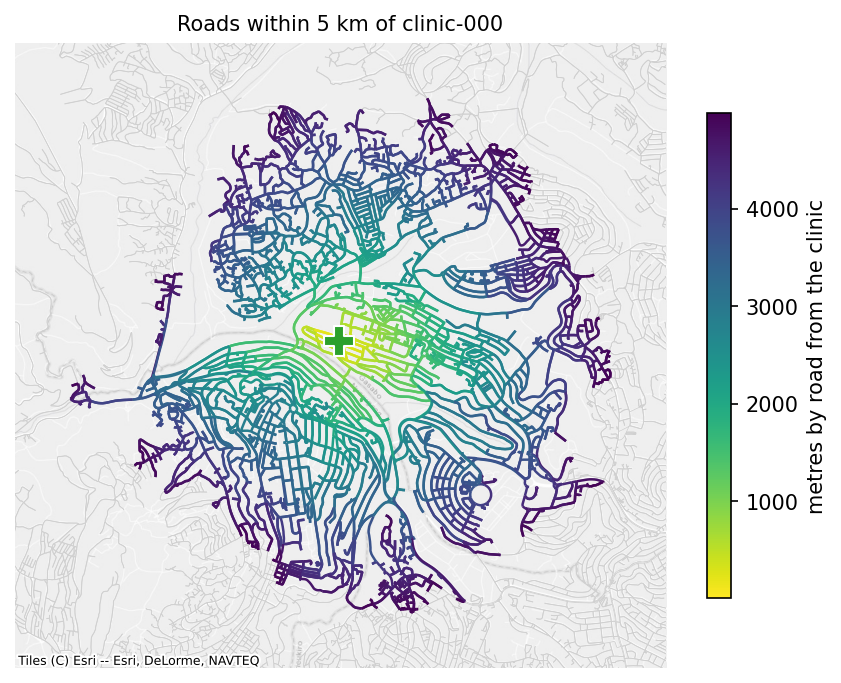

# Algorithms

Every algorithm runs on scipy's sparse graph routines (`scipy.sparse.csgraph`) by default. Shortest path lengths can also run on pandana, which is faster for very many pairs (see [below](#very-many-pairs-the-pandana-backend)). In a directed network, routes follow one-way roads; `directed=False` ignores them for one call. Unreachable pairs come back as `inf`, never as an error.

## The adjacency matrix

Every algorithm starts from a sparse matrix of the network: row and column \(i\) are the node at position \(i\) of `node_index`, and an entry is the weight of the edge between two nodes. Parallel edges keep their smallest weight. The matrix is built on first use and cached per weight and direction, so later calls pay nothing.

```python
started = time.perf_counter()
matrix = network.adjacency()
print(matrix.shape, f"{matrix.nnz:,} entries", f"{time.perf_counter() - started:.2f} s")
print(list(network.node_index[:3]))
```

```text
(125494, 125494) 330,649 entries 0.06 s
[271317577, 279244409, 279244410]
```

Results always come back with node IDs, not positions. `adjacency()` is there for your own sparse computations, with `node_index` to translate positions.

## Shortest path lengths

`shortest_path_lengths(origins, destinations)` returns a table with one row per origin and one column per destination, in metres (or in the weight you name).

```python
started = time.perf_counter()
to_fibre = network.shortest_path_lengths(school_ids, fibre_ids)
print(to_fibre.iloc[:3].round(0))
print(f"{len(school_ids)} by {len(fibre_ids)}: {time.perf_counter() - started:.2f} s")
```

```text
node_id     fibre-000  fibre-001  fibre-002  fibre-003  fibre-004
node_id                                                          
school-000     8937.0    12241.0     8273.0    17462.0    13567.0
school-001    10612.0     8455.0     4158.0    14607.0     9822.0
school-002     7944.0     6591.0     2293.0    12742.0     7957.0
197 by 5: 5.62 s
```

**How it works.** Dijkstra's algorithm, from each origin, on the cached matrix. One search costs \(O((V + E)\log V)\) and finds the distance to every node, so the cost grows with the number of origins, not with the number of destinations: about 25 ms per origin on Rwanda's roads. The library runs origins in blocks that keep the working matrix under 256 MiB, and refuses a result matrix over 1 GiB, with advice to batch, rather than run out of memory.

- **`pairwise=True`** pairs `origins[i]` with `destinations[i]` and returns one length per pair, which is what you need for a list of trips.
- **`directed=False`** ignores one-way restrictions, which suits walking or a cable along a road. A directed length is never shorter than the undirected one:

```python
undirected = network.shortest_path_lengths(school_ids, fibre_ids, directed=False)
gap = (to_fibre - undirected).stack()
print(f"One-way streets add {gap.mean():.0f} m on average, {gap.max():.0f} m at most")
```

```text
One-way streets add 66 m on average, 1302 m at most
```

**Use cases.** Road distance as a model feature, travel distances for cost estimates, and origin-destination matrices for planning.

## Road distance as a model feature

Straight-line distance understates how far a school is from anything, and by how much depends on the terrain and the roads. The ratio of the road distance to the straight-line distance, the detour index, measures that. It is a useful covariate on its own: a school with a detour index of 3 is cut off in a way its straight-line distance does not show.

```python
def great_circle(lat1, lon1, lat2, lon2, radius=6_371_009.0):
    lat1, lon1, lat2, lon2 = map(np.radians, (lat1, lon1, lat2, lon2))
    h = np.sin((lat2 - lat1) / 2) ** 2 + np.cos(lat1) * np.cos(lat2) * np.sin((lon2 - lon1) / 2) ** 2
    return 2 * radius * np.arcsin(np.sqrt(h))


nearest_clinic = network.nearest_by_network(school_ids, clinic_ids)
school_xy = network.nodes.loc[nearest_clinic["origin"], ["y", "x"]].to_numpy()
clinic_xy = network.nodes.loc[nearest_clinic["target"], ["y", "x"]].to_numpy()
features = nearest_clinic.assign(
    straight=great_circle(school_xy[:, 0], school_xy[:, 1], clinic_xy[:, 0], clinic_xy[:, 1])
)
features["detour"] = features["distance"] / features["straight"]
print(features.head(4).round(2))
print(features[["distance", "straight", "detour"]].describe().round(2))
```

```text
       origin      target  distance  straight  detour
0  school-000  clinic-005   5239.91   4337.02    1.21
1  school-001  clinic-001   3072.66   1741.36    1.76
2  school-002  clinic-001    627.60    532.84    1.18
3  school-003  clinic-008   2857.87   1977.87    1.44
       distance  straight  detour
count    197.00    197.00  197.00
mean    4490.59   3127.79    1.50
std     2287.94   1723.44    0.34
min      207.82     88.06    1.05
25%     2967.47   1904.02    1.28
50%     4190.20   2852.59    1.41
75%     5935.87   4099.45    1.62
max    11626.62   8943.35    2.94
```

The straight line here is to the same clinic. The nearest clinic by road need not be the nearest in a straight line, which is one more reason to measure along the network.

## Routes

`shortest_paths` returns the routes themselves: lists of node IDs, or with `geometry=True` a GeoDataFrame with one line per route, drawn along the roads' geometries.

```python
first = nearest_clinic.head(3)
routes = network.shortest_paths(first["origin"].tolist(), first["target"].tolist(), geometry=True)
print(routes[["origin", "destination", "length"]].round(0))
print(routes.geometry.iloc[0].geom_type, len(routes["nodes"].iloc[0]), "nodes")
```

```text
       origin destination  length
0  school-000  clinic-005  5240.0
1  school-001  clinic-001  3073.0
2  school-002  clinic-001   628.0
LineString 48 nodes
```

Routes come from the same Dijkstra runs, with their predecessor arrays, walked back for all pairs at once. Drawing them along the edges' geometries costs more than the paths themselves (1.2 s against 0.34 s for 1,000 routes on Rwanda), so ask for `geometry=True` only when you need the lines.

## Service areas: what a facility reaches

`reachable(origins, max_distance)` lists every node within a road distance of each origin: a long table of origin, node, and distance.

```python
started = time.perf_counter()
reach = network.reachable(clinic_ids, 5000)
print(reach.head(3).round(0))
print(f"{len(reach):,} rows, {time.perf_counter() - started:.2f} s")
served = reach[reach["node_id"].isin(school_ids)]
print(f"Schools within 5 km of a clinic: {served['node_id'].nunique()} of {len(school_ids)}")
```

```text
       origin     node_id  distance
0  clinic-000  clinic-000       0.0
1  clinic-000        -184      14.0
2  clinic-000  1223026109      60.0
25,120 rows, 0.02 s
Schools within 5 km of a clinic: 125 of 197
```



**How it works.** Dijkstra from each origin, stopped at `max_distance`: it never looks past the limit, so it costs a fraction of a full search (0.08 s for 100 origins and 5 km on Rwanda, against 2.6 s without a limit).

**Use cases.** Accessibility (the schools a clinic serves), and service areas to map. Directions matter here: in a directed network the distances are from the origin outwards. For walking, pass `directed=False`.

## The nearest facility

`nearest_by_network(origins, targets, k=1)` gives each origin its nearest target by road and the distance to it, as in the detour example above. With `k` above 1, it gives the `k` nearest, nearest first.

```python
three = network.nearest_by_network(school_ids, clinic_ids, k=3)
print(three.head(6).round(0))
```

```text
       origin      target  distance
0  school-000  clinic-005    5240.0
1  school-000  clinic-007    5512.0
2  school-000  clinic-001    5710.0
3  school-001  clinic-001    3073.0
4  school-001  clinic-004    4405.0
5  school-001  clinic-003    5687.0
```

**How it works.** For `k=1`, the method does not search from every origin. One multi-source Dijkstra from all the targets at once finds, for every node, its nearest target and the distance to it, and the origins read their answer off. In a directed network the search runs on the reversed graph, so the distance is from the origin to the target. That makes it cheap however many origins there are: 0.05 s for 10,000 schools to 100 fibre nodes on Rwanda. For `k` above 1, it searches from each origin.

**Use cases.** Last-mile cost (each school's nearest fibre node), accessibility (each school's nearest clinic), and assigning facilities to the population they serve.

## Counting within a distance

`count_within(origins, targets, max_distance)` counts the targets each origin reaches within a distance: clinics within 5 km of each school, for example.

```python
clinics_near = network.count_within(school_ids, clinic_ids, 5000)
print(clinics_near.value_counts().sort_index())
```

```text
count
0    73
1    66
2    19
3    24
4    15
Name: count, dtype: int64
```

**How it works.** It runs limited Dijkstra searches from whichever side is smaller, the origins or the targets, and counts from there, reversing directions when it searches from the targets. With 10 clinics and 197 schools, it runs 10 searches.

**Use cases.** Accessibility indicators, such as the share of schools with at least one clinic within 5 km, or the number of other schools within reach for sharing resources.

## Connected components

`connected_components()` labels each node with its component, 0 being the largest. Weak components ignore directions; `strong=True` asks for components in which every node can reach every other along one-way roads.

```python
weak = network.connected_components()
strong = network.connected_components(strong=True)
print(f"Weak components: {weak.nunique()}, strong components: {strong.nunique()}")
outside = strong[strong != 0]
print(f"Nodes outside the largest strong component: {len(outside)}")
print("Schools among them:", sorted(set(outside.index) & set(school_ids))[:5])
```

```text
Weak components: 1, strong components: 11
Nodes outside the largest strong component: 11
Schools among them: []
```

A network loaded through `OSMRoadsHandler` keeps only its largest weakly connected part, so it has one weak component. Strong components show where one-way streets trap a route: a node outside the largest strong component can be reached but not left, or left but not reached, by a car that obeys the one-way signs. For a cable, that does not matter; for a delivery route, it does.

**`largest_component()`** keeps the largest component as a network.

**`connect_components(max_distance=None)`** joins disconnected parts with `component_link` edges between their nearest nodes. The links form a minimum spanning tree over the components, by great-circle distance, found with Borůvka's method: each round, every component finds its nearest node outside itself, and the shortest of those links join components, until one is left or the remaining gaps exceed `max_distance`. In a directed network each link is added in both directions.

Clipping Kigali out of Rwanda's network with `clip`, in [Editing](editing.md#selecting-part-of-a-network), left a few pieces cut off: roads that leave the box and come back into it lost the part outside.

```python
pieces = kigali_roads.connected_components()
print(pieces.value_counts().head(4))
joined = kigali_roads.connect_components(max_distance=1000)
links = joined.edges[joined.edges["kind"] == "component_link"]
print(f"Components before: {pieces.nunique()}, after: {joined.connected_components().nunique()}")
print(f"Link edges added: {len(links)}, the longest {links['length'].max():.0f} m")
```

```text
component
0    23744
1       36
2       32
3        3
Name: count, dtype: int64
Components before: 13, after: 2
Link edges added: 22, the longest 917 m
```

**Use cases.** Network diagnostics: finding where OpenStreetMap is missing a road, and bridging small gaps so that routing does not fail on data errors. The links are straight lines, not roads, and are marked as such, so they can be reported or priced differently.

## Minimum spanning tree

`minimum_spanning_tree()` keeps the edges that join every node at the smallest total weight, ignoring directions. scipy computes it with Kruskal's algorithm. Applied to the network of links between schools from [Getting a network](getting-a-network.md#points-joined-to-their-neighbours-from_points), it is the shortest set of point-to-point links that connects them all:

```python
tree = school_links.minimum_spanning_tree()
print(school_links)
print(tree)
print(f"All links: {school_links.total_length() / 1000:.0f} km, the tree: {tree.total_length() / 1000:.0f} km")
```

```text
SpatialNetwork(nodes=200, edges=488, directed=False, weight='length')
SpatialNetwork(nodes=200, edges=199, directed=False, weight='length')
All links: 531 km, the tree: 157 km
```

A tree over a disconnected network is a forest, one tree per component. scipy ignores zero-weight edges, so the library replaces zero weights by the smallest positive number for that call.

**Use cases.** Wireless or microwave backhaul between schools, where links are straight lines between towers, not roads. For fibre along roads, use [`connecting_subnetwork`](reduction.md#keeping-the-roads-that-connect-a-set-of-points), which finds a tree through the road network instead.

## Very many pairs: the pandana backend

pandana answers shortest path queries with contraction hierarchies: it preprocesses the network once (about 1.4 s for Rwanda), then answers each pair in microseconds. `backend="pandana"` uses it for `shortest_path_lengths`; it needs the `pandana` extra.

Here it computes the road distance from every school to every clinic, as pairs:

```python
origins = np.repeat(school_ids, len(clinic_ids))
destinations = np.tile(clinic_ids, len(school_ids))
for backend in ("scipy", "pandana"):
    started = time.perf_counter()
    lengths = network.shortest_path_lengths(origins, destinations, pairwise=True, backend=backend)
    print(f"{backend}: {len(lengths):,} pairs in {time.perf_counter() - started:.2f} s (pandana's includes its build)")
    if backend == "scipy":
        reference = lengths
print(f"Largest difference: {np.abs(lengths - reference).max():.2f} m")
```

```text
scipy: 1,970 pairs in 5.09 s (pandana's includes its build)
pandana: 1,970 pairs in 1.81 s (pandana's includes its build)
Largest difference: 0.11 m
```

scipy's cost grows with the number of origins (about 25 ms each on Rwanda), and pandana's with the number of pairs once it is built. pandana's preprocessing costs as much as about 55 origins of scipy work, so it pays off for large origin-destination matrices, and not for a few hundred origins. It stores weights with limited precision, so its lengths differ from scipy's by a fraction of a metre. The backend works on any network; `to_pandana()`, which gives you pandana's network itself, indexed by node ID, needs node IDs that are all integers or all text (see [Storage and interoperability](storage.md#pandana)).
