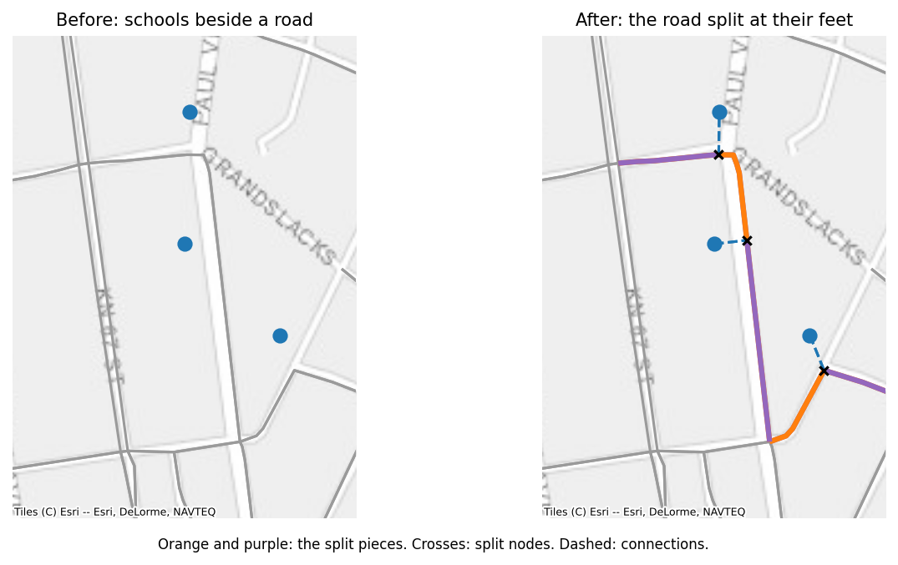

# Inserting points

Most questions about schools start by putting the schools on the road network. `insert_points` does that: each point becomes a node, joined to its nearest road.

**Use cases.** Every road-distance question needs it: last-mile cost to the nearest fibre node, access to clinics, road distance as a model feature. It is also the first step of fibre planning.

## What it does

```python
started = time.perf_counter()
network, skipped = roads.insert_points(schools, id_column="school_id", max_distance=500, return_skipped=True)
print(f"Schools: {time.perf_counter() - started:.2f} s, {len(skipped)} skipped")
network = network.insert_points(fibre_nodes, id_column="fibre_id", max_distance=500)
network = network.insert_points(clinics, id_column="clinic_id", max_distance=500)
summary = network.info()
print(summary["node_kinds"])
print(summary["edge_kinds"])
```

```text
Schools: 1.52 s, 3 skipped
{'road': 125095, 'point': 212, 'split': 183}
{'road': 332284, 'split': 714, 'connection': 424}
```

For each point, the method finds the nearest road edge and the foot of the perpendicular on it: the point on the road closest to the school. It splits the road there, at a new node of kind `split`, and adds a `connection` edge from the school (kind `point`) to that node. The school's columns, such as `students`, become node attributes.

```python
school = "school-000"
print(network.nodes.loc[[school], ["x", "y", "kind", "students"]])
connection = network.edges[network.edges["u"] == school]
print(connection[["u", "v", "length", "kind"]])
split_node = connection["v"].iloc[0]
pieces = network.edges[(network.edges["u"] == split_node) & (network.edges["kind"] == "split")]
print(pieces[["u", "v", "length", "kind"]])
```

```text
                    x         y   kind  students
node_id                                         
school-000  30.146086 -1.944989  point    1167.0
                 u     v     length        kind
332938  school-000  -102  26.341664  connection
           u           v      length   kind
332677  -102  6294807498  159.216257  split
332679  -102  1612911824  177.157333  split
```



The split node has a negative ID, continuing below the lowest negative ID in the network, as OpenStreetMap numbers new objects. In a directed network, connections run both ways, and both directions of a two-way road are split at the same node, so a route can arrive from either side.

## Lengths are kept

The pieces of a split road are rescaled so they add up exactly to the road's length. Inserting a point never changes the length of a route that passes it.

```python
by_kind = network.total_length(by="kind")
print(by_kind.round(0))
print(f"Roads before: {roads.total_length():,.0f} m")
print(f"Roads and split pieces after: {by_kind['road'] + by_kind['split']:,.0f} m")
```

```text
kind
road          106045370.0
split            182330.0
connection        29550.0
Name: length, dtype: float64
Roads before: 106,227,700 m
Roads and split pieces after: 106,227,700 m
```

A connection's length is the great-circle distance from the point to its foot, measured with the same formula as the roads. When the network's weight is not `length`, connections get a weight equal to their length, and each road piece gets its share of the road's weight, in proportion to its length.

Every other attribute of the road is copied to both pieces unchanged. That is right for a road's name, class, speed limit, or cost per metre, and wrong for a total such as a cost per edge, which would then be counted twice. Compute totals after inserting points, from the pieces' lengths, as the `with_fibre_cost` function from [Editing](editing.md#attributes-and-weights) does. Connection edges have no road attributes at all.

## The options

- **`max_distance`.** A point farther than this from every road is skipped, with a warning, and `return_skipped=True` returns those points. Schools hundreds of metres from any mapped road are usually a sign of missing roads in OpenStreetMap, or of wrong coordinates, and are worth looking at before trusting their distances.

```python
print(skipped)
```

```text
      school_id       lat        lon  students
32   school-032 -2.018585  30.156109       343
96   school-096 -2.016976  30.169052       201
186  school-186 -2.016365  30.158554       428
```

- **`snap_to_node`.** When the foot is within this many metres (5 by default) of the edge's end, the point connects to that node instead of splitting the road. This avoids slivers of road a few centimetres long next to junctions. Set it to 0 to always split.
- **`chain`.** With `chain=True`, points nearest to a road are handled first, and a point joins an already inserted point (with a `point_link` edge) when that point is closer than any road. This reproduces how Giga's earlier code connected clusters of schools in a compound, where a school behind another school would otherwise reach the road through it anyway.

```python
chained = roads.insert_points(schools, id_column="school_id", max_distance=500, chain=True)
print(chained.info()["edge_kinds"])
```

```text
{'road': 332316, 'split': 644, 'connection': 380, 'point_link': 14}
```

- **`id_column`.** The column with the point IDs; the frame's index otherwise. IDs must not repeat, and must not already be node IDs: inserting the same schools twice raises.

## How it works

Joining one point to its nearest road is easy; doing it for ten thousand points at country scale is where the old approach broke down. Giga's earlier `merge_points_to_graph` handled points one at a time, compared each point with every earlier one, and rebuilt a table for each, so its cost grew with the square of the number of points: 292 s for 1,000 schools on Rwanda's roads. `insert_points` handles all points in one batch, and takes 0.6 s for the same 1,000 schools and 1.7 s for 10,000:

1. **Find each point's road.** One nearest-geometry query on an R-tree of the road edges finds every point's nearest edge. The search runs in a UTM projection estimated from the network, because in degrees a road 100 m east can look farther than one 150 m north. UTM is conformal, so it ranks nearby candidates correctly even outside its zone. The projected index is built once per network (1.3 s for Rwanda) and reused by later insertions.
2. **Find the feet.** `line_locate_point` and `line_interpolate_point`, vectorised over all points, give where along its edge each point's foot lies.
3. **Group by edge.** Points are grouped by their edge and sorted by position along it. Points whose feet fall on the same spot share one split node.
4. **Split each road once.** Each affected edge is cut at all of its points in one pass. Distances that decide anything (`max_distance`, `snap_to_node`) are measured in great-circle metres, never in the projection.
5. **Append.** The new nodes and edges are added in one step.

Only step 4 loops in Python, and it loops over affected edges, not points. `chain=True` adds a KD-tree on the points, which asks for more neighbours only for the points whose neighbours are still closer than their road.

## Things to know

- Points join roads only. Connections and links from earlier insertions are never split, so inserting fibre nodes after schools does not connect a fibre node to a school's connection.
- A point is joined to the nearest road edge, whatever it is: a service road, a track if the network type includes tracks, or a one-way street. Choose the `network_type` with that in mind; `"drive_service"`, the default, includes the service roads that often lead to schools.
- `simplify` never removes nodes of kind `point` or `split`, so a network with inserted points can be simplified without losing them (see [Reduction](reduction.md)).
