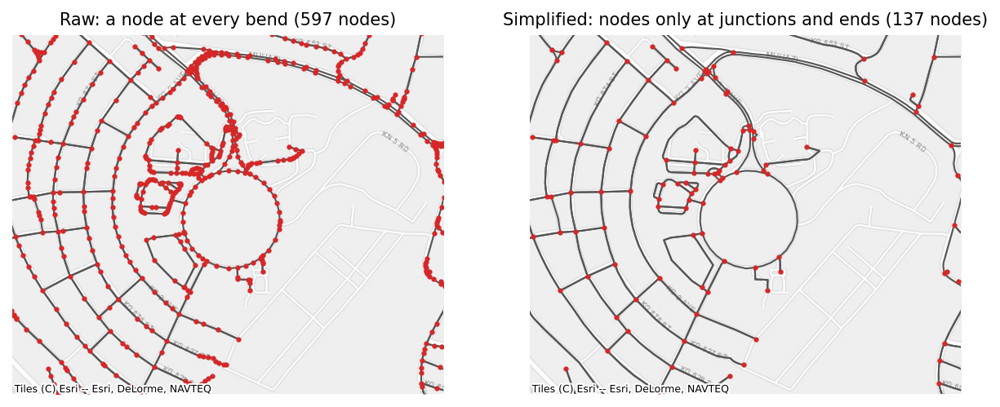
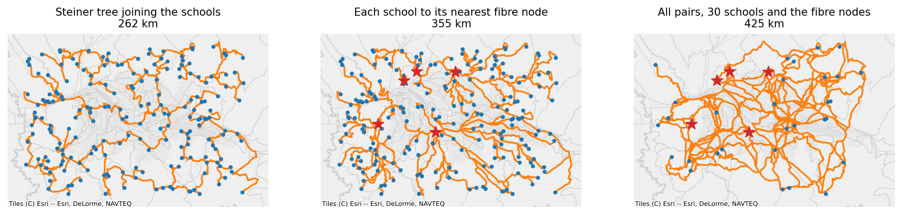

# Reduction

Two methods make a network smaller without losing what matters: `simplify` removes the nodes that only continue a road, and `connecting_subnetwork` keeps only the roads that join a set of points.

## Simplifying a network

OpenStreetMap draws a road as a chain of many short segments, so an unsimplified road network has a node at every bend. `simplify` removes the nodes that only continue a road and joins the edges on either side, the way osmnx's `simplify_graph` does. Networks from `OSMRoadsHandler` and `OSMRoadsFetcher` are simplified by default; `simplify=False` gives the raw network.

```python
raw_kigali = handler.load_data(kigali, simplify=False)
started = time.perf_counter()
simple_kigali = raw_kigali.simplify()
print(raw_kigali)
print(simple_kigali, f"{time.perf_counter() - started:.2f} s")
```

```text
SpatialNetwork(nodes=166,206, edges=342,706, directed=True, weight='length')
SpatialNetwork(nodes=23,722, edges=61,611, directed=True, weight='length') 0.65 s
```



**Which nodes go.** A node is removed when it has exactly two neighbours and its edges continue through it: one edge in and one out of a one-way road, or both directions of a two-way road. In an undirected network, it is a node with exactly two edges. Nodes of kind `point` and `split`, and nodes passed in `keep=`, are never removed, so a network with inserted schools keeps its schools.

**How joined edges are made.** A joined edge's attributes come from the edges it replaces:

| Attribute | Rule |
|---|---|
| `length`, the weight column, and columns in `sum_columns` | added up |
| `geometry` | one line along the joined edges |
| text, such as `highway` and `name` | joined with `;` where the parts differ, without repeats |
| `osmid` and other lists | concatenated, without repeats |
| `oneway` | true only if every part is one-way |
| `reversed` | true if any part is |
| other numbers | the length-weighted mean |
| `kind` | the kind of the longest part |

```python
joined = simple_kigali.edges[simple_kigali.edges["highway"].astype(str).str.contains(";")].iloc[0]
print(joined[["u", "v", "length", "osmid", "highway", "oneway"]])
```

```text
u                        1224173076
v                        6370565775
length                   384.393696
osmid        [106060663, 680376414]
highway    unclassified;residential
oneway                        False
Name: 17137, dtype: object
```

Each direction of a two-way road is joined separately, so it stays two-way when both directions can be joined.

**How it works.** `simplify` never walks a chain of edges in Python. Each edge into a removable node is linked to the edge that continues it, which turns every chain into a linked list; pointer jumping ranks each edge's place in its chain in a logarithmic number of vectorised steps; and numpy's `reduceat` aggregates the attributes of every chain at once. On Rwanda's unsimplified network of 4.5 million edges this takes 7 s, against 148 s for osmnx, with the same nodes and edge lengths.

**Where it differs from osmnx.** osmnx also removes the nodes between two duplicated parallel ways and drops one of the ways, and it deletes rings that have no junction at all, such as a roundabout mapped on its own. `simplify` keeps both, so no road is lost. Neither occurs often; in Rwanda's roads, neither occurs at all.

## Keeping the roads that connect a set of points

`connecting_subnetwork` answers a fibre planner's question: which roads would carry the cable to these schools? It keeps the part of the network that joins the points, and contracts it to the points and the places where the paths branch. It works on the undirected network, since a cable laid along a road ignores one-way restrictions.

```python
inserted = set(network.node_index)
school_ids = [school for school in schools["school_id"] if school in inserted]
fibre_ids = [fibre for fibre in fibre_nodes["fibre_id"] if fibre in inserted]
clinic_ids = [clinic for clinic in clinics["clinic_id"] if clinic in inserted]

for label, call in [
    ("Steiner tree joining the schools", lambda: network.connecting_subnetwork(school_ids)),
    ("each school to its nearest fibre node", lambda: network.connecting_subnetwork(school_ids, sources=fibre_ids)),
    ("all pairs, 30 schools and the fibre nodes", lambda: network.connecting_subnetwork(school_ids[:30], sources=fibre_ids, method="all_pairs")),
]:
    started = time.perf_counter()
    result = call()
    print(f"{label}: {result.total_length() / 1000:.1f} km, {len(result.edges)} edges, {time.perf_counter() - started:.2f} s")
```

```text
Steiner tree joining the schools: 261.6 km, 476 edges, 0.39 s
each school to its nearest fibre node: 355.2 km, 526 edges, 0.07 s
all pairs, 30 schools and the fibre nodes: 424.7 km, 748 edges, 0.92 s
```



[Open the interactive version of this map](../../assets/spatial-network/connecting-subnetworks.html){target="_blank"} to zoom in on the routes.

The three methods answer different questions:

**`method="steiner"`, without sources (the default).** The tree that joins all the points at close to the smallest total length: a Steiner tree, which may use road junctions as branching points. It is the model for a backbone that links every school to every other, such as a ring of schools sharing one uplink. Finding the shortest Steiner tree is NP-hard, so the method uses Mehlhorn's approximation:

1. One multi-source Dijkstra from all the points gives every node its nearest point, which splits the network into one region per point (a Voronoi partition by road distance).
2. Every edge whose ends lie in two different regions is a candidate link between those two points, with a length of the distance from each end to its point plus the edge itself. The cheapest link is kept for each pair of points.
3. A minimum spanning tree over those links picks the pairs to join. Each chosen link is expanded back into its road path.
4. A second minimum spanning tree over the roads in those paths removes any cycles, and leaves that are not points are pruned.

The result is never more than twice as long as the shortest possible tree, \(2(1 - 1/\ell)\) times it for \(\ell\) leaves, and in practice it is close. The test suite checks that it is never longer than networkx's two approximations on the same network. Its cost is one multi-source Dijkstra and two spanning trees, whatever the number of points: 0.18 s for 1,000 schools on Rwanda's roads.

**With `sources=`.** Each point takes its shortest path to its nearest source, such as each school to its nearest fibre node, and the result is the union of those paths. It is the model when every school must reach some fibre node and the schools need not reach each other. One multi-source Dijkstra from the sources gives every point its nearest source and the path to it.

**`method="all_pairs"`.** The shortest path between every point and every other point or source, as Giga's earlier code computed it. It shows every route that might matter, but the number of paths grows with the square of the number of points, so keep it for small sets.

In every case, the paths are collected from Dijkstra's predecessor arrays all at once, and the result is contracted with `simplify(keep=points and sources)`, so it keeps the points, the sources, and the branching nodes, with lengths added up and geometries joined. `weight="cost"` minimises another column, such as the cost of laying fibre (see [Worked use cases](use-cases.md)). A point that cannot reach the others stays in the result as a node without edges.

**Use cases.** Fibre backbone planning (the Steiner tree), extending fibre from existing nodes (with `sources`), and estimating the trench length or cost of a plan, which is `total_length()` of the result or the sum of its cost column.

## How a source is cut from an extract

`OSMRoadsHandler` stores each extract's whole network, uncropped, and cuts it to a source when it loads. To give the same network `OSMRoadsFetcher` would, it replays the steps of osmnx's `graph_from_polygon`:

1. **Widen the area.** The source becomes an area by the fetcher's rules (a country's boundary, a geometry as given, a frame's union, or points' hull, bounding box, or buffers), and the area is widened by 500 m, as osmnx widens what it downloads. The raw network's nodes in the widened area are kept; with `truncate_by_edge=True`, so are the nodes just outside that share an edge with one inside.
2. **Combine extracts.** When a source needs several extracts, such as schools along a border, their raw networks are combined as if they were one file: a road that crosses between extracts is in both, and is kept once.
3. **Keep the largest connected part, and simplify,** unless `retain_all=True` keeps every part.
4. **Cut to the area.** The nodes in the area itself are kept, and the largest connected part again. `street_count` is the count on the simplified widened network, as osmnx sets it.

Simplifying the widened network before cutting it decides what happens to a road that leaves the area: its simplified edge runs to the next real junction outside, so the edge's far end is outside the area and the edge is dropped. That is what osmnx does, and the handler does the same, so a cropped load equals the fetcher's network for the same area. A country whose extracts are its own file, or its regional files, is not cropped at all.
