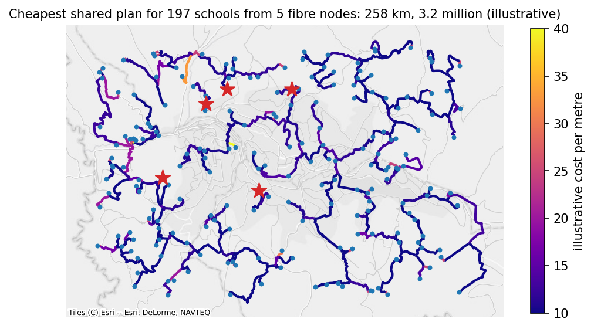

# Worked use cases

This page puts the methods together for two applications, fibre planning and accessibility, and ends with how to turn network results into features for a statistical model. It continues the example: `network` is Rwanda's roads with the 200 schools, 5 fibre nodes, and 10 clinics inserted.

## Fibre backbone planning

**The question.** Which roads would carry fibre from the existing fibre nodes to the schools, how long would the cable be, what would it cost, and in which order should the schools be connected?

**1. Price the network.** The costs per metre from [Editing](editing.md#attributes-and-weights) are applied now, after the points are inserted, so that every split piece and connection gets its own cost:

```python
planned = with_fibre_cost(network)
print(planned.edges.groupby("kind", observed=True)[["length", "cost"]].sum().round(0))
```

```text
                 length          cost
kind                                 
road        106043551.0  1.293426e+09
split          184149.0  2.374447e+06
connection      29550.0  7.387490e+05
```

**2. Compare plans.** Each school can take its own shortest route to the nearest fibre node, or its own cheapest route. Or the schools can share one plan, connecting through each other where that saves cable, made by `ConnectionPlanner` with the fibre nodes as roots, by length or by cost, and improved:

```python
from gigaspatial import ConnectionPlanner

by_length = ConnectionPlanner(planned, school_ids, roots=fibre_ids)
by_cost = ConnectionPlanner(planned, school_ids, roots=fibre_ids, weight="cost")
shortest = by_length.improve(by_length.plan())
cheapest = by_cost.improve(by_cost.plan())
plans = {
    "each school's shortest route to the nearest fibre node": by_length.plan("nearest_root").network,
    "each school's cheapest route to a fibre node": by_cost.plan("nearest_root").network,
    "one shared plan, shortest": shortest.network,
    "one shared plan, cheapest": cheapest.network,
}
for label, plan in plans.items():
    cost = (plan.edges["rate"] * plan.edges["length"]).sum()
    print(f"{label}: {plan.total_length() / 1000:.1f} km, cost {cost / 1e6:.2f} million")
by_cost.lower_bound(cheapest)
print(f"The cheapest shared plan costs at most {cheapest.gap:.1%} more than the best possible one.")
```

```text
each school's shortest route to the nearest fibre node: 355.2 km, cost 5.52 million
each school's cheapest route to a fibre node: 365.3 km, cost 4.46 million
one shared plan, shortest: 244.1 km, cost 3.64 million
one shared plan, cheapest: 257.7 km, cost 3.19 million
The cheapest shared plan costs at most 1.3% more than the best possible one.
```

The plan's cost is the rate times the length of each of its edges. The plans are contracted networks, whose edges join many road segments, and a joined edge's rate is the length-weighted mean of its parts, so this total is exact (see [Editing](editing.md#attributes-and-weights)).

Sharing cuts the length by almost a third (244 against 355 km), and the cost by more than a quarter (3.19 against 4.46 million for each school's own cheapest route), because schools near each other share one trench instead of each running its own to a fibre node. Pricing by cost avoids main roads where a residential street does the job, at some extra length. Whether a shared plan is acceptable depends on how much a failure of one shared segment would matter. Joining the schools and the fibre nodes in one tree, without roots, would also be shorter than separate routes, but it pays to connect fibre nodes that the backbone already connects.



[Open the interactive version of this map](../../assets/spatial-network/fibre-plan.html){target="_blank"} to check which roads the plan takes.

**3. A phased rollout.** A plan by `shortest_path`, the default, connects the schools one at a time, cheapest connection first, to everything connected so far. Each school's `order` and `marginal_cost` turn the plan into phases:

```python
rollout = by_cost.plan()
phases = rollout.terminals.dropna(subset=["order"]).sort_values("order")
phases["students"] = planned.nodes.loc[phases.index, "students"].to_numpy()
phases["phase"] = pd.qcut(phases["order"].astype(int), 4, labels=["first", "second", "third", "fourth"])
summary = phases.groupby("phase", observed=True).agg(
    schools=("order", "size"), students=("students", "sum"), cost=("marginal_cost", "sum")
)
summary["cost per pupil"] = summary["cost"] / summary["students"]
summary["cost"] = summary["cost"] / 1e6
print(summary.round(2))
```

```text
        schools  students  cost  cost per pupil
phase                                          
first        50   34373.0  0.62           18.14
second       49   34771.0  0.63           18.08
third        49   28388.0  0.81           28.47
fourth       49   30391.0  1.18           38.87
```

The first phases reach the schools nearest the fibre and those that connect through them, at about 18 per pupil; the last reaches the remote schools, at about 39. A school's marginal cost depends on what was connected before it: it is what this order adds, not what the school would cost alone.

**4. Last-mile distances.** The road distance from each school to its nearest fibre node decides which schools are worth connecting first. Weighting by students turns it into a statement about pupils:

```python
last_mile = planned.nearest_by_network(school_ids, fibre_ids)
last_mile["students"] = planned.nodes.loc[last_mile["origin"], "students"].to_numpy()
bands = pd.cut(last_mile["distance"], [0, 2000, 5000, 10000, np.inf], labels=["under 2 km", "2-5 km", "5-10 km", "over 10 km"])
print(last_mile.groupby(bands, observed=False).agg(schools=("origin", "size"), students=("students", "sum")))
```

```text
            schools  students
distance                     
under 2 km       10    7001.0
2-5 km           65   40515.0
5-10 km          92   62469.0
over 10 km       30   17938.0
```

**What to check before trusting a plan.** Schools that were skipped because they lie far from any road (see [Inserting points](inserting-points.md#the-options)) are missing from every plan, and schools with `status` `unreachable` are in no part of the network with fibre; `bridge_cost=` lets the plan cross such gaps by straight-line links. Roads missing from OpenStreetMap make routes longer than they are; `connect_components` and a look at the schools with the longest detours find most of them. A plan's `gap` says how far above the best possible plan it can be at most. And a plan along roads assumes the cable follows roads, which is the usual case but not the only one.

## Accessibility

**The question.** Which schools have a clinic within reach by road, and which are left out?

```python
nearest = planned.nearest_by_network(school_ids, clinic_ids)
within_5km = planned.count_within(school_ids, clinic_ids, 5000)
access = pd.DataFrame(
    {
        "nearest_clinic_m": nearest.set_index("origin")["distance"],
        "clinics_within_5km": within_5km,
        "students": planned.nodes.loc[school_ids, "students"],
    }
)
print(access.describe().round(0))
share = (access["clinics_within_5km"] > 0).mean()
pupils = int(access.loc[access["clinics_within_5km"] == 0, "students"].sum())
print(f"Schools with a clinic within 5 km by road: {share:.0%}; pupils without one: {pupils:,}")
```

```text
       nearest_clinic_m  clinics_within_5km  students
count             197.0               197.0     197.0
mean             4491.0                 1.0     649.0
std              2288.0                 1.0     311.0
min               208.0                 0.0      82.0
25%              2967.0                 0.0     405.0
50%              4190.0                 1.0     644.0
75%              5936.0                 2.0     924.0
max             11627.0                 4.0    1198.0
Schools with a clinic within 5 km by road: 63%; pupils without one: 45,658
```

**Road distance against straight-line distance.** The same question asked with straight lines gives a rosier answer, because no road is shorter than the straight line:

```python
straight_5km = features.set_index("origin")["straight"] <= 5000
road_5km = access["nearest_clinic_m"] <= 5000
print(pd.crosstab(straight_5km.rename("within 5 km straight"), road_5km.rename("within 5 km by road")))
```

```text
within 5 km by road   False  True 
within 5 km straight              
False                    34      0
True                     39    124
```

The schools that are within 5 km in a straight line but not by road are the ones a straight-line indicator would misclassify. They are worth listing by name in any report on access.

**Service areas.** For a map of what each clinic serves, `reachable(clinic_ids, 5000)` lists every node within 5 km of each clinic, and the service area figure on the [Algorithms](algorithms.md#service-areas-what-a-facility-reaches) page draws one. In a directed network the distances run from the clinic outwards; for walking, pass `directed=False`.

## Network distance as a model feature

Road distances, detours, and counts within reach are covariates like any other once they are in a table keyed by school. Here they are joined to the schools, ready for a model of, say, attendance or connectivity:

```python
model_table = (
    schools.set_index("school_id")
    .join(access[["nearest_clinic_m", "clinics_within_5km"]])
    .join(features.set_index("origin")[["detour"]])
    .join(last_mile.set_index("origin")["distance"].rename("fibre_m"))
    .dropna()
)
print(model_table.head(3).round(2))
print(model_table[["nearest_clinic_m", "detour", "fibre_m", "students"]].corr().round(2))
```

```text
             lat    lon  students  ...  clinics_within_5km  detour  fibre_m
school_id                          ...                                     
school-000 -1.94  30.15      1167  ...                 0.0    1.21  8273.25
school-001 -1.91  30.12       448  ...                 2.0    1.76  4157.80
school-002 -1.93  30.11      1025  ...                 3.0    1.18  2293.00

[3 rows x 7 columns]
                  nearest_clinic_m  detour  fibre_m  students
nearest_clinic_m              1.00   -0.09     0.57     -0.08
detour                       -0.09    1.00    -0.09     -0.04
fibre_m                       0.57   -0.09     1.00     -0.03
students                     -0.08   -0.04    -0.03      1.00
```

A few things are worth knowing when you use them:

- Road distances are long-tailed: a few schools are much farther than the rest. A logarithm, or distance bands as above, usually fits better than the raw metres.
- The detour index is a ratio and is unstable for very short straight-line distances; for a school next to its clinic, a 300 m road around a block gives a large ratio for a small detour. Consider leaving out pairs under a few hundred metres.
- Counts within a distance depend on the threshold. Report the threshold, and check that results do not hinge on it.
- Directed and undirected distances answer different questions. A car obeys one-way streets; a pupil on foot does not.
- The made-up points here are uniform at random; real schools cluster along roads, so real detours are smaller.
